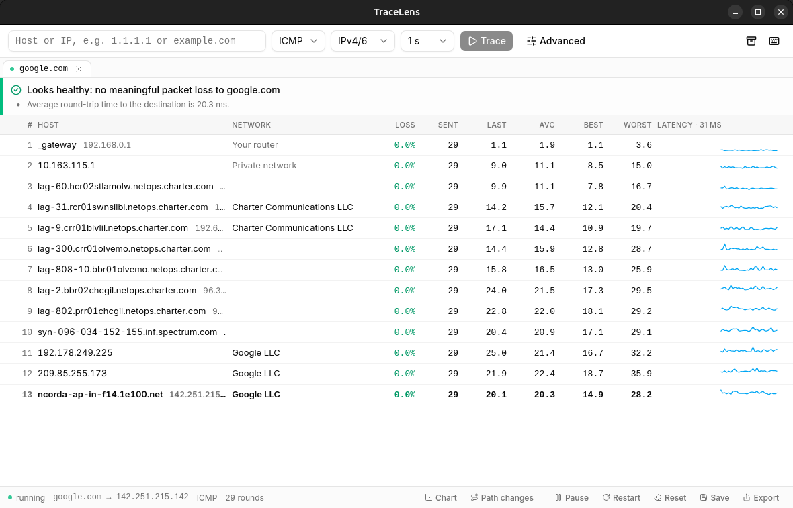
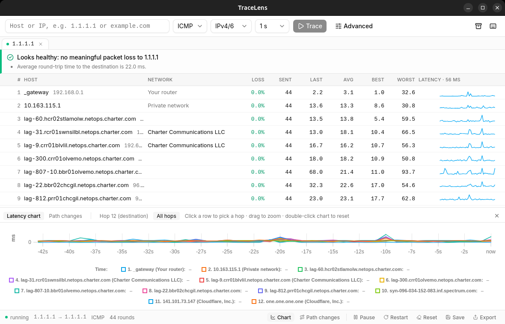
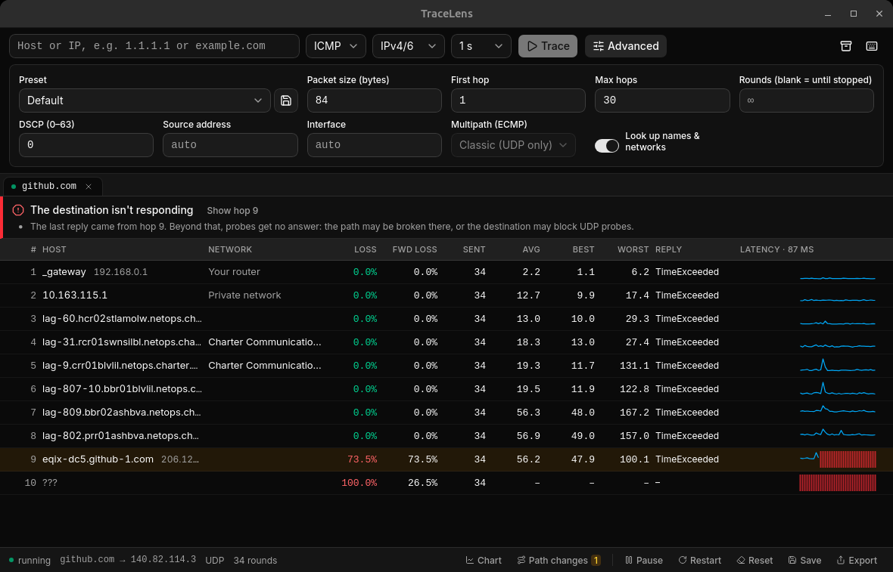

# TraceLens

A cross-platform desktop app for **MTR-style network path diagnostics**. Type a host, press
Enter, and TraceLens continuously traces every hop to it: per-hop packet loss and latency,
who operates each hop, and a plain-English verdict on whether there's a problem and where it starts.

It's simple enough to run before calling your ISP, and has the depth power users expect:
ICMP/UDP/TCP probes, ECMP strategies, extra columns, path-change logging, and trippy-compatible JSON.

<picture>
  <source media="(prefers-color-scheme: dark)" srcset="docs/screenshots/main-dark.png">
  
</picture>

## Features

**For everyone**

- **Plain-English verdict** above the table: "Looks healthy", "12% packet loss starting at hop 7
  (Example ISP)", and it explicitly calls out loss at a middle hop that *doesn't* continue as normal,
  which is mtr's most common misreading.
- **Who owns each hop**: network names from ASN lookups ("Cloudflare, Inc.", "Your router", "Private network").
- **Share results**: copy as Markdown (for tickets and chat), plain text, CSV or JSON, or save a PNG image.
- **History**: recent targets in the host box; save traces, reopen them later, and compare two side by side.
- Multiple traces in tabs, each running in the background. Follows the OS light/dark theme.

**For power users**

- **Advanced options**: packet size, first/max hop, rounds, source address, interface, DSCP,
  ECMP strategy (Classic / Paris / Dublin), and saved presets ("VoIP check", "Web server (TCP 443)", …).
- **Optional columns** (right-click the table header): forward vs. return-path loss, jitter avg/max/interarrival,
  last ICMP reply type, NAT detection, MPLS labels, DSCP/ECN.
- **Right-click a hop**: copy IP or hostname, WHOIS lookup, trace to that hop, show every address seen there (multipath).
- **Latency chart** for one hop or the whole trace, and a **path-change log** ("hop 6 changed from X to Y at 14:32")
  for spotting route flapping.
- **Keyboard-first**: `Ctrl/⌘+L` focus host, `Ctrl/⌘+T` new trace, `Space` pause, `R` reset, `Ctrl/⌘+W` close,
  `Ctrl/⌘+S` save, `Ctrl/⌘+Shift+C` copy Markdown, `G` chart, `P` path log, `Ctrl/⌘+/` all shortcuts.
- **Command line**: `tracelens 1.1.1.1 --udp` opens straight into a trace; `tracelens example.com --report`
  prints an mtr-style report without opening a window.

| Latency chart | Advanced options & dark mode |
|---|---|
|  |  |

## Install

**Linux / macOS**, one line:

```sh
curl -fsSL https://raw.githubusercontent.com/UltraSive/tracelens/main/install.sh | sh
```

It picks the right build for your system: the `.deb` (via apt) or `.rpm` (via dnf/zypper/yum) on Linux,
and the app bundle into `/Applications` on macOS. Set `TRACELENS_VERSION=v0.1.0` to pin a release.
[Read the script](install.sh) first if you prefer.

**Windows**, or to install by hand: download the installer from [Releases](https://github.com/UltraSive/tracelens/releases).

Tracing sends raw ICMP/UDP/TCP packets, which every OS restricts:

| OS | What you need |
|---|---|
| **Linux** | The `.deb` / `.rpm` grant the binary `CAP_NET_RAW` on install, so no root needed. For a source build: `sudo setcap cap_net_raw+ep <path-to-binary>`. A downloaded AppImage can't hold that permission (it runs from a `nosuid` mount); the install script unpacks it and grants it to the binary inside. |
| **Windows** | The app asks for Administrator (UAC) on launch; Windows only allows raw sockets for admins. |
| **macOS** | ICMP works without privileges. UDP/TCP modes may need `sudo`. Builds are unsigned: right-click, then **Open**, the first time. |

## Command line

```text
tracelens [TARGET] [OPTIONS]

  -u, --udp / -T, --tcp / --icmp   probe protocol (default ICMP)
  -4 / -6                          force IPv4 / IPv6
  -P, --port <PORT>                destination port (UDP/TCP)
  -i, --interval <SECS>            time between rounds (default 1)
  -c, --rounds <N>                 stop after N rounds
  -f, --first-ttl / -m, --max-ttl  hop range
  -s, --size <BYTES>               packet size
      --source <ADDR> / -I <IFACE> send from a specific address / interface
      --dscp <0-63>                DSCP marking
      --multipath <classic|paris|dublin>
  -n, --no-dns                     skip hostname / ASN lookups
  -r, --report                     no window: trace, print a report and exit
```

## Building from source

Prerequisites: Rust (stable), Node 20+, and the [Tauri prerequisites](https://tauri.app/start/prerequisites/)
for your OS. On Debian/Ubuntu:

```sh
sudo apt install libwebkit2gtk-4.1-dev libgtk-3-dev librsvg2-dev libayatana-appindicator3-dev \
  libdbus-1-dev libssl-dev build-essential pkg-config
```

```sh
npm install
npm run tauri dev                  # development
npm run tauri build                # installers in target/release/bundle/
cargo test -p mtr-engine           # engine + verdict tests
```

On Linux, every Rust rebuild produces a new binary without the capability, so re-run
`sudo setcap cap_net_raw+ep target/debug/tracelens` (or `target/release/tracelens`) after rebuilding.

## Releasing

Releases are built by GitHub Actions (`.github/workflows/release.yml`) for Linux (x64), macOS
(Apple Silicon and Intel) and Windows (x64):

1. Bump the version in `src-tauri/tauri.conf.json`, `src-tauri/Cargo.toml` and `package.json`.
2. Commit, then tag and push: `git tag v0.2.0 && git push origin main v0.2.0`.
3. The workflow checks the tag matches the app version, builds every platform, and attaches the
   installers to a **draft** release. Review it and click Publish.

## How it's built

```text
crates/engine/   UI-independent engine: wraps trippy-core; sessions, snapshots, verdict,
                 reverse DNS + ASN (Team Cymru via trippy-dns), report/export formats
src-tauri/       Tauri 2 backend: commands, 2 Hz snapshot events, saved traces & prefs, CLI
src/             SvelteKit (SPA) + Tailwind 4 + shadcn-svelte frontend
```

- Probing is done by [`trippy-core`](https://crates.io/crates/trippy-core), the engine behind
  [Trippy](https://github.com/fujiapple852/trippy).
- `trippy-core` has no cancel/pause API, so pause blocks the tracer between rounds and stop unwinds
  its thread with `resume_unwind` from the per-round callback. Both take effect at the end of a round.
- trippy-core's unprivileged mode only works on macOS, so Linux needs `CAP_NET_RAW`
  (`net.ipv4.ping_group_range` doesn't help).
- JSON export matches `trip --mode json` so existing tooling can read it. Saved traces use a richer
  internal format (full samples, path events and verdict).
- Saved traces live in the OS app-data directory (`.../global.cosmic.tracelens/traces/`); preferences
  (recent targets, presets, columns) in the app-config directory.

## License

[MIT](LICENSE)
